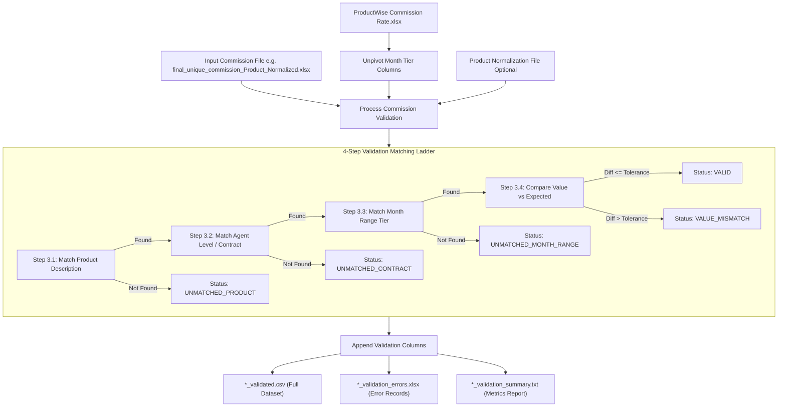

# Commission Extraction Validation Guide (`validate_extracted_commission.py`)

## Executive Summary

The [`validate_extracted_commission.py`](file:///Users/nirmalrajaak/pieq/Insurance/pieq-policy-file-import-extraction/validate_extracted_commission.py) script cross-verifies policy commission values extracted from carrier files (such as `final_unique_commission_Product_Normalized.xlsx`) against the master Product Commission rate sheet (`ProductWise Commission Rate.xlsx`). It validates rate percentages, fixed dollar amounts, agent contract levels, month tier ranges, and product aliases.

---

## 🏗️ Processing Pipeline Workflow



---

## 🔍 Step-by-Step Validation & Table Processing Breakdown

### Step 1: Master Rate Table Parsing & Unpivoting (`unpivot_product_commission_rates`)

#### Input Master File (`ProductWise Commission Rate.xlsx` - Raw Wide Format):
| Product ID | Product Description | Contract | From-To Months | Rate (Percentage) | Rate (Dollar Amount) | Column Rate is Fixed | From-To Months.1 | Rate (Percentage).1 | Rate (Dollar Amount).1 |
| :--- | :--- | :--- | :--- | :--- | :--- | :--- | :--- | :--- | :--- |
| PROD101 | Medica 2025 AZ IA NE OK | LVL5 | 1-12 | 0.00 % | $18.00 | N | 13-0 | 0.00 % | $18.00 |
| PROD202 | Dental Premier | LVL1 | 1-12 | 70.00 % | $0.00 | N | 13-0 | 15.00 % | $0.00 |

#### Unpivoted Output Rules Table (`df_rules` Lookup DataFrame):
| Product_ID | Product_Description | Contract | From_Month | To_Month | Rate_Percentage | Rate_Dollar | Is_Fixed |
| :--- | :--- | :--- | :--- | :--- | :--- | :--- | :--- |
| PROD101 | Medica 2025 AZ IA NE OK | LVL5 | 1 | 12 | 0.00 | 18.00 | N |
| PROD101 | Medica 2025 AZ IA NE OK | LVL5 | 13 | 9999 | 0.00 | 18.00 | N |
| PROD202 | Dental Premier | LVL1 | 1 | 12 | 70.00 | 0.00 | N |
| PROD202 | Dental Premier | LVL1 | 13 | 9999 | 15.00 | 0.00 | N |

#### 📝 Description of Working & Processing:
1. Master Excel contains horizontal repeated blocks (`.1`, `.2`, ..., `.16`) for up to 17 month-tier rules per product.
2. `unpivot_product_commission_rates()` flattens wide columns into structured lookup rows.
3. String ranges (e.g. `"1-12"`) are split into `From_Month = 1` and `To_Month = 12`.
4. Open-ended tiers (e.g. `"13-0"`) convert `To_Month` from `0` to `9999` (onwards).
5. Percentages stored as decimals (e.g. `0.70`) are scaled to percentage numbers (`70.0%`).

---

### Step 2: Product Name Alias Normalization (`load_product_normalization`)

#### Input Extracted Commission File Row (`final_unique_commission_Product_Normalized.xlsx`):
| Policy No | Product | Contract | From Month | Carrier Commission | Payout Method |
| :--- | :--- | :--- | :--- | :--- | :--- |
| 30372009472 | Medica 2025 AZ IA NE OK | LVL5 | 1 | $18.00 | FIXED FEE |

#### Input Product Normalization Reference Table (`Final Product Normalization Local.xlsx`):
| Product *(Raw Carrier Name)* | New Product Name *(Canonical Name)* |
| :--- | :--- |
| Medica 2025 AZ IA NE OK | Medica 2025 AZ IA NE OK |
| BCBS TX Small Group | BCBS of TX SG |

#### 📝 Description of Working & Processing:
1. `load_product_normalization()` loads mapping pairs from reference Excel/CSV into a dictionary.
2. Product names are stripped of whitespace and quotes, and converted to lowercase keys.
3. If an extracted product match is found, the canonical `New Product Name` replaces the raw product name during master lookup.

---

### Step 3.1: Product Description Matching

#### Input Extracted Commission File Row:
| Policy No | Product | Contract | From Month | Carrier Commission | Payout Method |
| :--- | :--- | :--- | :--- | :--- | :--- |
| 30372009472 | **Medica 2025 AZ IA NE OK** | LVL5 | 1 | $18.00 | FIXED FEE |

#### Master Sheet Filtered Rules Table (`df_rules` for Matched Product):
| Product_Description | Contract | From_Month | To_Month | Rate_Percentage | Rate_Dollar |
| :--- | :--- | :--- | :--- | :--- | :--- |
| **Medica 2025 AZ IA NE OK** | LVL5 | 1 | 12 | 0.00 % | $18.00 |
| **Medica 2025 AZ IA NE OK** | LVL5 | 13 | 9999 | 0.00 % | $18.00 |

#### 📝 Description of Working & Processing:
1. Normalizes `Product` (case-insensitive, whitespace-collapsed).
2. Filters `df_rules` for matching `Product_Description` (exact match or fallback substring search).
3. **If Product is NOT found**:
   - `Validation_Status = UNMATCHED_PRODUCT`
   - `Validation_Error_Reason = "Product '...' not found in ProductWise Commission Rate table."`

---

### Step 3.2: Agent Level / Contract Matching

#### Input Extracted Commission File Row:
| Policy No | Product | Contract | From Month | Carrier Commission | Payout Method |
| :--- | :--- | :--- | :--- | :--- | :--- |
| 30372009472 | Medica 2025 AZ IA NE OK | **LVL5** | 1 | $18.00 | FIXED FEE |

#### Master Sheet Contract Filtered Rules Table:
| Product_Description | Contract | From_Month | To_Month | Rate_Percentage | Rate_Dollar |
| :--- | :--- | :--- | :--- | :--- | :--- |
| Medica 2025 AZ IA NE OK | **LVL5** | 1 | 12 | 0.00 % | $18.00 |

#### 📝 Description of Working & Processing:
1. Normalizes `Contract` / `Agent Level` name (handles variations like `LVL5` vs `LVL 5` or `Level 5`).
2. Filters product rules for `Contract == LVL5`.
3. **If Contract is NOT found for this product**:
   - `Validation_Status = UNMATCHED_CONTRACT`
   - `Validation_Error_Reason = "Contract/Agent Level '...' not found for product '...'"`

---

### Step 3.3: Month Tier Range Verification

#### Input Extracted Commission File Row:
| Policy No | Product | Contract | From Month | Carrier Commission | Payout Method |
| :--- | :--- | :--- | :--- | :--- | :--- |
| 30372009472 | Medica 2025 AZ IA NE OK | LVL5 | **1** | $18.00 | FIXED FEE |

#### Matched Single Master Baseline Rule:
| Product_Description | Contract | From_Month | To_Month | Rate_Percentage | Rate_Dollar |
| :--- | :--- | :--- | :--- | :--- | :--- |
| Medica 2025 AZ IA NE OK | LVL5 | **1** | **12** | 0.00 % | $18.00 |

#### 📝 Description of Working & Processing:
1. Converts `From Month` to integer (e.g. `1`).
2. Checks if `From_Month (1) <= Policy Month (1) <= To_Month (12)`.
3. **If Month is OUTSIDE range tiers**:
   - `Validation_Status = UNMATCHED_MONTH_RANGE`
   - `Validation_Error_Reason = "Month 1 is out of rate tier ranges for product '...' / '...'"`

---

### Step 3.4: Group Carrier Commission & 100% Sequence Split Conversion Verification

#### Input Extracted Policy Group Rows (`final_unique_commission_Product_Normalized.xlsx`):
*Grouped by `(Policy No: 394835, Product: BCBS of TX SG, From Month: 1)`*

| Policy No | Product | Sequence | Agent Name | Contract | From Month | Rate *(Split Share)* | Amount | Carrier Commission *(Total Benchmark)* | Payout Method |
| :--- | :--- | :--- | :--- | :--- | :--- | :--- | :--- | :--- | :--- |
| 394835 | BCBS of TX SG | 1 | RICARDO SANTOS | LVL4 | 1 | **80.00 %** | $0.00 | **75.00 %** | PERCENTAGE |
| 394835 | BCBS of TX SG | 2 | JANE DOE | Sales Leader | 1 | **20.00 %** | $0.00 | **75.00 %** | PERCENTAGE |

#### Matched Master Baseline Rule (`ProductWise Commission Rate.xlsx`):
| Product Description | Contract | From-To Months | Rate (Percentage) | Rate (Dollar Amount) |
| :--- | :--- | :--- | :--- | :--- |
| BCBS of TX SG | LVL4 | 1-12 | **75.00 %** | $0.00 |

#### 📝 Description of Working & Processing:
1. **Group Carrier Commission Check**:
   - Compares the group's benchmark `Carrier Commission` (**75.00%**) against the expected master rate (**75.00%**).
   - If total agency rate differs $\rightarrow$ assigns `Validation_Status = VALUE_MISMATCH`.
2. **Sequence Split Share Conversion Check**:
   - Sums sequence line-item `Rate` values across all sequences in the group:
     $$\text{Split Rate Sum} = 80.00\% + 20.00\% = 100.00\%$$
   - Confirms that the 75.00% benchmark rate has been converted into relative sequence split shares summing to **100.00%**.
   - If split rates do not sum to 100.00% $\rightarrow$ assigns `Validation_Status = INVALID_SEQUENCE_SPLIT`.

---

### Step 4: Final Output Generation & Reporting

#### Final Processed Output Group Rows (`final_unique_commission_validated.csv`):
| Policy No | Product | Sequence | Agent Name | Contract | From Month | Rate | Carrier Commission | Payout Method | **Validation_Status** | **Expected_Base_Commission** | **Commission_Variance** | **Validation_Error_Reason** |
| :--- | :--- | :--- | :--- | :--- | :--- | :--- | :--- | :--- | :--- | :--- | :--- | :--- |
| 394835 | BCBS of TX SG | 1 | RICARDO SANTOS | LVL4 | 1 | 80.00 % | 75.00 % | PERCENTAGE | **VALID** | **75.00 %** | **0.00** | *(None)* |
| 394835 | BCBS of TX SG | 2 | JANE DOE | Sales Leader | 1 | 20.00 % | 75.00 % | PERCENTAGE | **VALID** | **75.00 %** | **0.00** | *(None)* |

#### Error Report Group Rows (`final_unique_commission_validation_errors.xlsx`):
*Example when extracted group Carrier Commission is 50.00% instead of 75.00%:*

| Policy No | Product | Sequence | Contract | From Month | Carrier Commission | **Validation_Status** | **Expected_Base_Commission** | **Commission_Variance** | **Validation_Error_Reason** |
| :--- | :--- | :--- | :--- | :--- | :--- | :--- | :--- | :--- | :--- |
| 394835 | BCBS of TX SG | 1 | LVL4 | 1 | 50.00 % | **VALUE_MISMATCH** | **75.00 %** | **25.00** | Group Carrier Commission mismatch: Extracted benchmark rate '50.00 %' vs expected '75.00 %' |
| 394835 | BCBS of TX SG | 2 | Sales Leader | 1 | 50.00 % | **VALUE_MISMATCH** | **75.00 %** | **25.00** | Group Carrier Commission mismatch: Extracted benchmark rate '50.00 %' vs expected '75.00 %' |

#### Summary Report File (`final_unique_commission_validation_summary.txt`):
```text
==================================================
      COMMISSION VALIDATION SUMMARY REPORT        
==================================================
Input Path:               batch_1/Final Data/Commission/final_unique_commission_Product_Normalized.xlsx
Master Commission Table:  tests/ProductWise Commission Rate.xlsx
Total Records Checked:    31,482
Valid Records:            30,120 (95.67%)
Total Error Records:      1,362
--------------------------------------------------
Error Breakdown:
  • Rate/Dollar Mismatches: 820
  • Invalid Sequence Splits: 340
  • Unmatched Products:     152
  • Unmatched Agent Levels: 35
  • Unmatched Month Range:  15
--------------------------------------------------
Execution Time:           4.85 seconds
==================================================
```

---

## 🛠️ Command Line Usage

```bash
python validate_extracted_commission.py \
  --commission-input "batch_1/Final Data/Commission/final_unique_commission_Product_Normalized.xlsx" \
  --product-commission-file "ProductWise Commission Rate.xlsx" \
  --norm-file "Final Product Normalization Local.xlsx" \
  --output-dir "pipeline_output/commission_validation" \
  --tolerance 0.01
```

### CLI Arguments Reference:
| Flag | Short Flag | Required | Default | Description |
| :--- | :--- | :--- | :--- | :--- |
| `--commission-input` | `-i` | **Yes** | N/A | Input CSV/Excel file or directory of extracted policy commission records. |
| `--product-commission-file` | `-p` | `tests/ProductWise Commission Rate.xlsx` | Master product commission rates Excel file (`ProductWise Commission Rate.xlsx`). |
| `--norm-file` | `-n` | `Final Product Normalization Local.xlsx` | Optional reference file for product name aliases. |
| `--output-dir` | `-o` | `pipeline_output/commission_validation` | Output directory path for validation reports. |
| `--tolerance` | `-t` | `0.01` | Numerical tolerance threshold for variance checks. |
