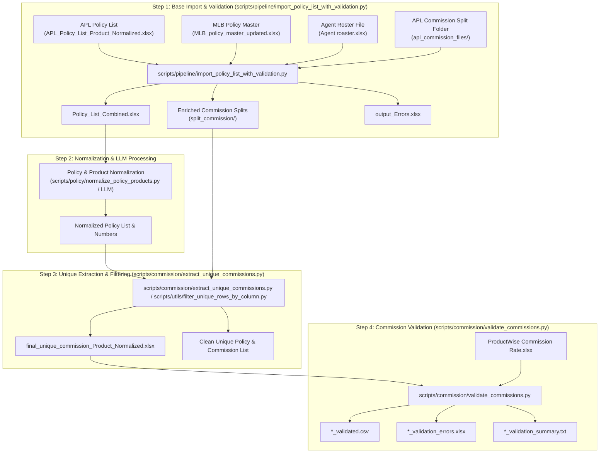

# 🚀 PieQ Policy & Commission Import Extraction Utility

An enterprise-grade Python suite for validating policy import lists, processing multi-tier agent commission splits, enriching carrier metadata, normalizing products, validating extracted commission rates against baseline rules, and extracting clean, deduplicated carrier import files.

---


## 🚀 Setup & Usage

### 1. Prerequisites
- Python 3.9+
- Recommended: Create a virtual environment (`python3 -m venv .venv` and `source .venv/bin/activate`)

### 2. Installation
```bash
pip install -r requirements.txt
```

### 3. Running Scripts
The utility scripts have been organized into the `scripts/` directory by domain:
- **Pipeline (`scripts/pipeline/`)**: Run these to execute multi-step workflows. Example: `python3 scripts/pipeline/run_full_policy_pipeline.py`
- **Policy (`scripts/policy/`)**: Normalization, enrichment, and validation of base policies.
- **Commission (`scripts/commission/`)**: Commission calculation and splits processing.
- **Utils (`scripts/utils/`)**: Generic CSV/Excel file manipulation utilities.
- **DB Validation (`scripts/db_validation/`)**: Contains tools for cross-verifying extracted commissions against the database.

Each sub-directory contains its own `README.md` with details on individual scripts.

---

## 📋 Executive Overview

In the insurance industry, policy list imports and carrier commission files arrive from multiple sources with missing fields, multi-agent commission splits, unnormalized product descriptions, and carrier-level overrides. 

This repository provides an automated, end-to-end data processing pipeline that:
1. **Validates Policy Import Lists**: Matches raw policy files against Master Policy databases, populating missing metadata (`Carrier`, `LOB`, `Agent Level`, `Payment Frequency`, `Premium`) and isolating invalid records into an error file.
2. **Propagates Policy Carrier Metadata**: Automatically fills missing `Carrier` and policy attributes across all secondary agent split tiers (e.g. Sales Leader, Agency) so related policy records stay grouped together.
3. **Calculates Sequence-Based Commission Splits**: Automatically computes incremental line item amounts and relative split percentage shares (`Rate`) for multi-sequence commission structures.
4. **Tracks Benchmark Carrier Commission & Payout Method**:
   - **`Carrier Commission`**: Captures the overall benchmark value for the policy period (either total rate **`30.00 %`** or total dollar amount **`$150.00`**).
   - **`Payout Method`**: Automatically identifies whether the commission structure is **`PERCENTAGE`** (rate-based) or **`FIXED FEE`** (dollar-based).
5. **Normalizes Product Descriptions**: Standardizes product names (e.g. mapping `"Medica 2025 AZ IA NE OK"` to canonical names) using mapping reference tables.
6. **Validates Commission Rates against Master Tiers**: Cross-verifies extracted carrier commission values in files like `final_unique_commission_Product_Normalized.xlsx` against `ProductWise Commission Rate.xlsx` to detect rate errors, unmatched agent levels, or tier range discrepancies.
7. **Extracts Carrier-Wise Split Files**: Automatically splits clean policy lists and commission datasets into individual carrier files (`Aetna.csv`, `Humana.csv`, `Medica.csv`, etc.).

---

## 💡 How It Works (Simplified for Business & Operations)

### Scenario A: Rate-Based Commission Split (`Payout Method = PERCENTAGE`)

#### Raw Input (Before Processing)
A single policy `CLI7115324` has 3 commission sequences with a total carrier rate of **30.0 %**:

| Sequence | Agent Name | Status | From Month | Rate *(Raw)* | Amount |
|---|---|---|---|---|---|
| 1 | MATTHEW DAUGHERTY | Active | 1 | **20.0 %** | $0.00 |
| 2 | GREG TEIPEL | Active | 1 | **25.0 %** | $0.00 |
| 3 | MAIN LINE BENEFITS | Active | 1 | **30.0 %** | $0.00 |

#### Processed Output (After Pipeline Execution)
- **`Carrier Commission`** = **30.00 %** (the overall carrier benchmark rate).
- **`Payout Method`** = **`PERCENTAGE`**
- **`Rate`** = Computed split percentage share for each line item (`66.66 %`, `16.66 %`, `16.68 %`).
- **`Carrier`** = Propagated across **all** split rows so all 3 agents stay in `Aetna.csv`.

| Policy No | Sequence | Agent Name | Agent Level | Rate *(Split Share)* | Carrier Commission *(Total Benchmark)* | Payout Method | Carrier |
|---|---|---|---|---|---|---|---|
| CLI7115324 | 1 | MATTHEW DAUGHERTY | LVL 5.00 | **66.66 %** | **30.00 %** | **PERCENTAGE** | **Aetna** |
| CLI7115324 | 2 | GREG TEIPEL | Sales Leader | **16.66 %** | **30.00 %** | **PERCENTAGE** | **Aetna** |
| CLI7115324 | 3 | MAIN LINE BENEFITS | Agency | **16.68 %** | **30.00 %** | **PERCENTAGE** | **Aetna** |

*Validation: `66.66% + 16.66% + 16.68% = 100.00%` of the **30.00 %** total Carrier Commission.*

---

### Scenario B: Dollar-Based Commission Split (`Payout Method = FIXED FEE`)

#### Raw Input (Before Processing)
When the raw file specifies dollar amounts (as in `final_unique_commission_Product_Normalized.xlsx`), total carrier commission is **$18.00**:

| Sequence | Agent Name | Status | From Month | Rate *(Raw)* | Amount *(Raw)* |
|---|---|---|---|---|---|
| 1 | JACOB YALE | Active | 1 | **84.00 %** | **$15.12** |
| 2 | RICHARD YALE | Active | 1 | **6.99 %** | **$1.26** |

#### Processed Output (After Pipeline Execution)
- **`Carrier Commission`** = **$18.00** (total benchmark dollar amount).
- **`Payout Method`** = **`FIXED FEE`**
- **`Contract / Agent Level`** = `LVL5` / `Sales Leader` / `Agency`
- **`Carrier`** = `Medica`
- **Unallocated Amount Allocation**: The remaining unallocated balance (`$18.00 - ($15.12 + $1.26) = $1.62`, or `100.00% - (84.00% + 6.99%) = 9.01%`) is automatically set to **Agency** (`Sequence 3`, `MAIN LINE BENEFITS`).

| Policy No | Sequence | Agent Name | Contract | Amount | Rate *(Split Share)* | Carrier Commission | Payout Method | Carrier |
|---|---|---|---|---|---|---|---|---|
| 30372009472 | 1 | JACOB YALE | LVL5 | **$15.12** | **84.00 %** | **$18.00** | **FIXED FEE** | **Medica** |
| 30372009472 | 2 | RICHARD YALE | Sales Leader | **$1.26** | **6.99 %** | **$18.00** | **FIXED FEE** | **Medica** |
| 30372009472 | 3 | MAIN LINE BENEFITS | Agency | **$1.62** | **9.01 %** | **$18.00** | **FIXED FEE** | **Medica** |

*Validation: `$15.12 + $1.26 + $1.62 = $18.00` (100.00% of total Carrier Commission allocated).*


---

## 🔗 Policy Commission Grouping & Validation Rules

### 1. How Policy Commission is Grouped
Across all scripts in the pipeline (such as `scripts/policy/enrich_policy_commissions.py` and `scripts/commission/extract_unique_commissions.py`), commission records are grouped and processed using the following rules:

1. **Policy Grouping Key**: Records are grouped by **`Policy No`**. All line items sharing the same `Policy No` belong to a single policy commission group.
2. **Multi-Sequence Split Hierarchy**:
   - **`Sequence 1`**: Primary Writing Agent (e.g., `Contract = LVL5`).
   - **`Sequence 2, 3...`**: Secondary split recipients (e.g., `Sales Leader`, `Agency`).
3. **Carrier & Benchmark Metadata Propagation**:
   - The total benchmark **`Carrier Commission`** (e.g., `$18.00` or `30.00 %`) and **`Payout Method`** (`FIXED FEE` vs `PERCENTAGE`) are established from Sequence 1.
   - Core attributes (**`Carrier`**, **`LOB`**, **`Effective Date`**, **`Payment Frequency`**, **`Premium`**) are automatically propagated across **all** sequences within the policy group so secondary split agents stay grouped when splitting by Carrier.
4. **Split Share Calculation**:
   - **`Amount`**: Incremental dollar payout per sequence line item.
   - **`Rate`**: The agent's relative percentage split share of the total benchmark `Carrier Commission`.

---

### 2. How Validation Operates (`scripts/commission/validate_commissions.py`)
Each record in `final_unique_commission_Product_Normalized.xlsx` is validated against master baseline rules in `ProductWise Commission Rate.xlsx` using the following step-by-step evaluation table:

| Step | Validation Phase | Input Fields Evaluated | Master Sheet Matching Criteria (`ProductWise Commission Rate.xlsx`) | Success Action | Failure Action & Assigned Status |
| :--- | :--- | :--- | :--- | :--- | :--- |
| **Step 1** | **Unpivot Master Table** | Master Excel Columns (`From-To Months`, `Rate (Percentage)`, `Rate (Dollar Amount)`) | Unpivots up to 17 horizontal month-tier column blocks into structured lookup rules (`Product_Description`, `Contract`, `From_Month`, `To_Month`, `Rate_Percentage`, `Rate_Dollar`). | Rule lookup table `df_rules` built. | Aborts with error if master Excel file is corrupted or missing required tier columns. |
| **Step 2** | **Product Normalization (Optional)** | `Product` | Matches raw extracted product against `Final Product Normalization Local.xlsx` (`Product` $\rightarrow$ `New Product Name`). | Uses `New Product Name` for master lookup. | Retains raw extracted product name if normalization mapping is missing. |
| **Step 3.1** | **Product Lookup** | `Product` (or normalized name) | Matches `Product_Description` in master table (case-insensitive, space-tolerant, exact or substring match). | Proceeds to **Step 3.2**. | `Validation_Status = UNMATCHED_PRODUCT`<br>`Validation_Error_Reason = "Product '...' not found in ProductWise Commission Rate table."` |
| **Step 3.2** | **Contract / Agent Level Lookup** | `Contract` / `Agent Level` | Matches `Contract` in master table for the matched product (normalizes level spacing e.g., `LVL5` vs `LVL 5`). | Proceeds to **Step 3.3**. | `Validation_Status = UNMATCHED_CONTRACT`<br>`Validation_Error_Reason = "Contract/Agent Level '...' not found for product '...'"` |
| **Step 3.3** | **Month Tier Range Lookup** | `From Month` | Verifies `From_Month` $\le \text{Policy Month} \le$ `To_Month` (handles open-ended tiers e.g., `13-0` $\rightarrow$ `13` to `9999`). | Proceeds to **Step 3.4**. | `Validation_Status = UNMATCHED_MONTH_RANGE`<br>`Validation_Error_Reason = "Month ... is out of rate tier ranges..."` |
| **Step 3.4** | **Group Carrier Commission & 100% Split Conversion Check** | `Carrier Commission`, `Payout Method`, `Rate`, `Amount` | Compares group `Carrier Commission` (e.g. 75.00%) against master rule (`Rate_Percentage` / `Rate_Dollar`). Also verifies line-item sequence `Rate` values sum to 100.00% (the 100% converted split share). | `Validation_Status = VALID`<br>`Expected_Base_Commission = rate/dollar string`<br>`Commission_Variance = 0.0` | `Validation_Status = VALUE_MISMATCH` (if group rate differs) OR `INVALID_SEQUENCE_SPLIT` (if sequence rates do not sum to 100.00%). |
| **Step 4** | **Report Generation** | All Processed Records | Appends `Validation_Status`, `Expected_Base_Commission`, `Commission_Variance`, and `Validation_Error_Reason` to all records. | Exports `*_validated.csv`, `*_validation_errors.xlsx`, and `*_validation_summary.txt`. | Filters all non-`VALID` records into isolated error Excel file for operational review. |

---

## 📊 Commission File Schema Reference (`final_unique_commission_Product_Normalized.xlsx`)

The processed final normalized commission dataset contains 24 standard fields:

| Field Name | Type | Description | Sample Value |
| :--- | :--- | :--- | :--- |
| `Policy No` | String / Int | Unique Policy Identifier | `30372009472` |
| `Product` | String | Normalized Policy Product Name | `Medica 2025 AZ IA NE OK` |
| `Effective Date` | String | Policy Effective Date (`MM/DD/YYYY`) | `01/01/2026` |
| `Policy Status` | String | Current Policy Status | `Active` |
| `Sequence` | Int | Multi-agent commission split order | `1` |
| `Agent ID` | String | Unique Agent Identifier | `18754354` |
| `EACID` | Int | External Agent Code ID | `18754354` |
| `Agent Name` | String | Full Name of Agent | `JACOB YALE` |
| `Agent Status` | String | Agent Licensing Status | `Active` |
| `From Month` | Int | Commission Month Tier Start | `1` |
| `To Month` | Float / Int | Commission Month Tier End | `12.0` |
| `Rate` | String | Agent's relative split percentage share | `84.00 %` |
| `Amount` | String | Line item split amount | `$15.12` |
| `Fixed` | String | Fixed flag (`Yes`/`No`) | `No` |
| `Earning` | String | Earning eligibility flag | `Yes` |
| `Rate is same as default rate` | Float | Default rate flag | `NaN` |
| `Contract` | String | Agent Contract Tier | `LVL5` |
| `Carrier Commission` | String | Total benchmark rate/dollar amount for policy period | `$18.00` |
| `Payout Method` | String | Pay structure (`PERCENTAGE` vs `FIXED FEE`) | `FIXED FEE` |
| `Agent Level` | String | Primary Agent Level | `LVL5` |
| `Carrier` | String | Carrier Name | `Medica` |
| `LOB` | String | Line of Business | `Health` |
| `Payment Frequency` | String | Policy billing cycle | `Monthly` |
| `Premium` | Float | Policy Premium Amount | `1.0` |

---

---

## 🏗️ Registered End-to-End Pipeline Architecture & Workflow

The complete policy import, commission extraction, deduplication, and validation workflow consists of **4 distinct steps**:



---

## 🔄 Detailed 4-Step Registered Execution Flow

### Step 1: Base Import, Agent Roster Enrichment & Split Calculation
Matches the base APL Policy List against the MLB Policy Master database using the Agent Roster file to update Agent IDs and process APL Commission split files.

**Inputs Required:**
- **Base File**: `APL_Policy_List_Product_Normalized.xlsx`
- **Master File**: `MLB_policy_master_updated.xlsx`
- **Reference Roster**: `Agent roaster.xlsx` (updates/replaces Agent ID)
- **Commission Split Folder**: `apl_commission_files`

**Execution Command:**
```bash
python3 scripts/pipeline/import_policy_list_with_validation.py \
  --base-file "(AUG 3)PROCESSED MASTERS IMPORT/APL_Policy_List_Product_Normalized.xlsx" \
  --master-file "(AUG 3)PROCESSED MASTERS IMPORT/MLB_policy_master_updated.xlsx" \
  --output-file "(AUG 3)PROCESSED MASTERS IMPORT/Policy_Extraction" \
  --ref-file "(AUG 3)PROCESSED MASTERS IMPORT/Agent roaster.xlsx" \
  --base-split "(AUG 3)RAW MASTER DATA for POLICY COMMISSIONS IMPORT/apl_commission_files"
```

**Step 1 Outputs:**
- Clean enriched policy list (`Policy_List_Combined.xlsx`)
- Invalid records error file (`output_Errors.xlsx`)
- Enriched commission split files (`commission_import/` & `split_commission/`)

---

### Step 2: Policy, Product & Carrier Normalization
Normalizes product descriptions and populates carrier metadata across target policy files and directories. Features automated **fuzzy string matching** to handle typos and extra whitespace automatically.

**Execution Command (Single or Multiple Policy Files):**
```bash
python3 scripts/policy/normalize_policy_products.py \
  -n "Product-Carrier Sheet_updated.xlsx" \
  -p "(AUG 3)PROCESSED MASTERS IMPORT/Policy_Extraction/Policy_List_Combined.xlsx" "MLB_policy_master.xlsx" \
  -o "(AUG 3)PROCESSED MASTERS IMPORT/Policy_Extraction"
```

---

### Step 3: Unique Extraction & Commission Filtering
Searches for unique policy numbers across the normalized dataset using `scripts/commission/extract_unique_commissions.py` (or `scripts/utils/filter_unique_rows_by_column.py`). Filters out the extracted commission records from Step 1 against the unique policy list, generating the final deduplicated commission list and policy list.

**Execution Command:**
```bash
python3 scripts/commission/extract_unique_commissions.py \
  --policy-input "(AUG 3)PROCESSED MASTERS IMPORT/Policy_Extraction/Policy_List_Combined.xlsx" \
  --commission-input "(AUG 3)PROCESSED MASTERS IMPORT/Policy_Extraction/commission_import/split_commission" \
  --output-dir "(AUG 3)PROCESSED MASTERS IMPORT/unique_commission_import"
```

**Step 3 Output:**
- `final_unique_commission_Product_Normalized.xlsx` (Clean, deduplicated policy & commission list).

---

### Step 4: Extracted Commission Validation
Validates the extracted unique commission records against the baseline rules in `ProductWise Commission Rate.xlsx` to detect rate errors, contract level mismatches, or month tier range variances.

**Execution Command:**
```bash
python3 scripts/commission/validate_commissions.py \
  --commission-input "(AUG 3)PROCESSED MASTERS IMPORT/unique_commission_import/final_unique_commission_Product_Normalized.xlsx" \
  --product-commission-file "ProductWise Commission Rate.xlsx" \
  --norm-file "Final Product Normalization Local.xlsx" \
  --output-dir "(AUG 3)PROCESSED MASTERS IMPORT/commission_validation"
```

**Step 4 Reports Generated:**
- `*_validated.csv` (Full validated commission dataset with audit status)
- `*_validation_errors.xlsx` (Isolated error rows requiring operational review)
- `*_validation_summary.txt` (Executive summary breakdown of validation results)

---

## ⚡ Quick Start & Installation

### Environment Setup

1. Clone or navigate to the repository directory:
   ```bash
   cd pieq-policy-file-import-extraction
   ```

2. Create and activate a virtual environment:
   - **macOS / Linux:**
     ```bash
     python3 -m venv .venv
     source .venv/bin/activate
     ```
   - **Windows:**
     ```bash
     python -m venv .venv
     .venv\Scripts\activate
     ```

3. Install required dependencies:
   ```bash
   pip install -r requirements.txt
   ```

---

## 🛠️ Utility Reference & Command Options Guide

### 1. Unified Pipeline Execution (`scripts/pipeline/import_policy_list_with_validation.py`)

Runs Policy List Validation, Carrier Propagation, Commission Split Calculation, and Carrier Splitting in a single command.

```bash
python3 scripts/pipeline/import_policy_list_with_validation.py \
  --base-file <base_policy_list.xlsx> \
  --master-file <master_policy_database.xlsx> \
  --output-file pipeline_output/ \
  --ref-file <agent_roster.xlsx> \
  --base-split <commission_files_folder> \
  --yes
```

---

### 2. Commission Split Enrichment (`scripts/policy/enrich_policy_commissions.py`)

Processes commission files, performs sequence adjustments, populates `Carrier Commission` and `Payout Method`, and propagates Carrier across policy groups.

```bash
python scripts/policy/enrich_policy_commissions.py \
  --base-file <commission_file_or_folder> \
  --master-file <clean_policy_list.xlsx> \
  --output-dir pipeline_output/commission_import \
  --ref-file <agent_roster.xlsx>
```

---

### 3. Unique Commission Extraction (`scripts/commission/extract_unique_commissions.py`)

Looks up Policy Numbers from Policy Import outputs against Commission Structure files, extracts unique matching commission records, removes duplicates, and exports clean carrier files.

```bash
python scripts/commission/extract_unique_commissions.py \
  --policy-input pipeline_output/Policy_List_Combined.xlsx \
  --commission-input pipeline_output/commission_import/split_commission \
  --output-dir pipeline_output/unique_commission_import
```

---

### 4. Product & Carrier Normalization Utility (`scripts/policy/normalize_policy_products.py`)

Matches policy upload file(s) or folder(s) against a Product Normalization reference file. Updates the `Product` column with `New Product Name` and updates/adds the `Carrier` column. Features **fuzzy string matching** to resolve typos and spacing variations automatically.

**Single Policy File Usage:**
```bash
python3 scripts/policy/normalize_policy_products.py \
  -n "Product-Carrier Sheet_updated.xlsx" \
  -p "APL_Policy_List.xlsx" \
  -o "output_normalized/"
```

**Multiple Policy Files & Directories Usage:**
```bash
python3 scripts/policy/normalize_policy_products.py \
  -n "Product-Carrier Sheet_updated.xlsx" \
  -p "APL_Policy_List.xlsx" "MLB_policy_master.xlsx" "commission_files_folder/" \
  -o "output_normalized/"
```

**In-Place Overwrite Usage:**
```bash
python3 scripts/policy/normalize_policy_products.py \
  -n "Product-Carrier Sheet_updated.xlsx" \
  -p "APL_Policy_List.xlsx" "MLB_policy_master.xlsx" \
  --in-place
```

#### Arguments Reference:

| Argument | Short Flags | Required | Default | Description |
|---|---|---|---|---|
| `--norm-file` | `-n`, `-s`, `--source` | **Yes** | N/A | Path to reference lookup Excel/CSV file containing normalized products and carriers. |
| `--policy-file` | `-p`, `-t`, `--target` | **Yes** | N/A | Path to one or more target policy Excel/CSV files or directories. |
| `--output-dir` | `-o` | No | `{target}_normalized` | Directory path to save output normalized Excel/CSV files. |
| `--in-place` | N/A | No | `False` | Overwrites original target file(s) directly instead of saving to a new directory. |
| `--policy-prod-col` | N/A | No | `Product` | Product column name in target file(s) (auto-discovers `Product`, `Product Name`). |
| `--norm-prod-col` | N/A | No | `Product` | Product key column in normalization reference file. |
| `--norm-target-col` | N/A | No | `New Product Name` | New product target column in reference file (falls back to `Product`). |
| `--norm-carrier-col` | N/A | No | `Carrier` | Carrier column in reference file (auto-discovers `Carrier`, `New Carrier Name`). |

---

### 5. Commission Extraction Rate Validation (`scripts/commission/validate_commissions.py`)

Cross-verifies extracted commission datasets (such as `final_unique_commission_Product_Normalized.xlsx`) against master baseline rate rules in `ProductWise Commission Rate.xlsx`. Appends 4 validation metrics (`Validation_Status`, `Expected_Base_Commission`, `Commission_Variance`, `Validation_Error_Reason`).

```bash
python scripts/commission/validate_commissions.py \
  --commission-input "batch_1/Final Data/Commission/final_unique_commission_Product_Normalized.xlsx" \
  --product-commission-file "ProductWise Commission Rate.xlsx" \
  --norm-file "Final Product Normalization Local.xlsx" \
  --output-dir "pipeline_output/commission_validation" \
  --tolerance 0.01
```

#### Arguments Reference:

| Argument | Short Flag | Required | Default | Description |
|---|---|---|---|---|
| `--commission-input` | `-i` | **Yes** | N/A | Path to extracted commission Excel/CSV file or directory of files. |
| `--product-commission-file` | `-p` | `tests/ProductWise Commission Rate.xlsx` | Master product commission rates Excel file. |
| `--norm-file` | `-n` | `Final Product Normalization Local.xlsx` | Optional reference file for product name aliases. |
| `--output-dir` | `-o` | `pipeline_output/commission_validation` | Directory to save output reports (`*_validated.csv`, `*_validation_errors.xlsx`, `*_validation_summary.txt`). |
| `--tolerance` | `-t` | `0.01` | Numerical tolerance threshold for rate/dollar comparison. |

---

### 6. File & Directory Splitter (`scripts/utils/split_file.py`)

Groups and splits any Excel or CSV file (or directory of files) by a specified column name (e.g., `Carrier`).

```bash
python scripts/utils/split_file.py -f batch_1/Final Data/Commission/final_unique_commission_Product_Normalized.xlsx -c "Carrier"
```

---

### 7. Multi-Column Duplicate Detector (`find_duplicates.py`)

Identifies and isolates duplicate records based on user-selected columns.

```bash
python find_duplicates.py Policy_List.xlsx -c "Policy No" "Product" --separate
```

---

### 8. File Concatenation & Stacking (`scripts/utils/merge_files.py`)

Combines multiple Excel/CSV files into a single formatted file.

```bash
python scripts/utils/merge_files.py file1.xlsx file2.xlsx -o combined_output.xlsx
```

---

### 9. Effective Date & Month Range Calculation (`scripts/utils/normalize_effective_dates.py`)

Calculates elapsed duration from an `Effective Date` column and populates `From Month` and `To Month` ranges.

```bash
python scripts/utils/normalize_effective_dates.py -f policies.xlsx -c "Effective Date"
```

---

### 10. Column Value Update & Enrichment Utility (`update_columns.py`)

Matches target files or a target directory against a reference lookup file on single or composite key columns and updates or inserts specified target columns. Supports mapping different column names between the source (`-s`) file and target (`-t`) files for both **comparing (key) columns** and **updatable columns**.

**Standard usage (identical column names):**
```bash
python update_columns.py -s "Agent roster - Cleaned.xlsx" -k "Agent Name" -u "Agent ID" -t "Aetna.xlsx"
```

**Mapped column names via Colon Syntax (`SourceCol:TargetCol`):**
```bash
python update_columns.py -s "Agent roster.xlsx" -k "Ref Agent:Target Agent" -u "Ref Code:Target Code" -t "Aetna.xlsx"
```

**Mapped column names via explicit flags (`--target-key` & `--target-update-cols`):**
```bash
python update_columns.py -s "Agent roster.xlsx" -k "Ref Agent" --target-key "Target Agent" -u "Ref Code" --target-update-cols "Target Code" -t "Aetna.xlsx"
```

---

### 11. Carrier Reconciliation & Override (`scripts/policy/validate_and_fix_carriers.py`)

Compares commission files (e.g. `all_policies_enriched_merged.csv`) against the authoritative master policy import list (`Merged_Import.xlsx`). It verifies if carrier values match, overrides mismatched carriers in the commission file with the master carrier value, and outputs separate files for matched records, mismatched audit trails, and unmatched policies.

```bash
python scripts/policy/validate_and_fix_carriers.py -c "path/to/commission.csv" -m "path/to/master.xlsx" -o "path/to/output_dir"
```

#### Arguments Reference:

| Argument | Short Flag | Required | Default | Description |
|---|---|---|---|---|
| `--commission-file` | `-c` | No | `(AUG 3)PROCESSED MASTER.../commission_import/all_policies_enriched_merged.csv` | Path to the commission CSV input file. |
| `--master-file` | `-m` | No | `(AUG 3)PROCESSED MASTER.../Merged_Import.xlsx` | Path to the master reference policy Excel/CSV file. |
| `--output-dir` | `-o` | No | `(AUG 3)PROCESSED MASTER.../commission_import/validated_output` | Output directory path to save reports. |

---

### 12. Commission Roll-Up & Split Normalization Utility (`scripts/commission/normalize_commission_splits.py`)

Reads policy commission datasets, groups rows by `(Policy No, Product, From Month)`, and performs sequence differential roll-ups and percentage split normalizations so that:
1. **100% Split Normalization**: Sequence split rates (`Rate`) sum to exactly 100.00% split shares for each policy group.
2. **Fixed Fee Differential Conversion**: Converts cumulative tier amounts into incremental differential line-item amounts (`Amount`).
3. **Carrier Commission Pool & Payout Method**: Automatically populates `Carrier Commission` total benchmark values and assigns the `Payout Method` (`PERCENTAGE` vs `FIXED FEE`).
4. **Unallocated Balance Allocation**: Automatically sets any remaining unallocated commission pool balance (`$18.00 - ($15.12 + $1.26) = $1.62` / `9.01%`) to the **Agency** tier (`Sequence 3`).

```bash
python scripts/commission/normalize_commission_splits.py -i input_commission.xlsx -o normalized_output.xlsx
```

#### Arguments Reference:

| Argument | Short Flag | Required | Default | Description |
|---|---|---|---|---|
| `--input` | `-i` | **Yes** | N/A | Path to input policy commission Excel or CSV file. |
| `--output` | `-o` | No | `{input}_normalized` | Output path for normalized Excel or CSV file. |

---

### 13. APL & ICM Cross Validation (`apl_icm_cross_validation/validate_apl_icm.py`)

Interactively cross-validates policy, agent name, and commission amounts directly between APL Statements and ICM (Parallel Run) payables. It handles `OVR` prefix/suffix removal during matching and automatically groups its run into versioned `input/` and `output/` folders.

```bash
python3 apl_icm_cross_validation/validate_apl_icm.py
```
*(The script will prompt you for the paths to the two required input files.)*

---

## 🧪 Automated Testing

Run the full automated test suite using Python's built-in `unittest` runner:

```bash
python -m unittest discover tests
```

### Included Test Modules:
- `tests/test_enrich_commission.py`: Verifies `Carrier Commission` and `Payout Method` logic for both percentage and fixed-fee modes.
- `tests/test_scripts/commission/extract_unique_commissions.py`: Tests policy key extraction, commission matching, and deduplication.
- `tests/test_policy_import_errors.py`: Tests error separation, missing carrier handling, and validation rules.
- `tests/test_splitter.py`: Tests single-file and directory splitting logic.
