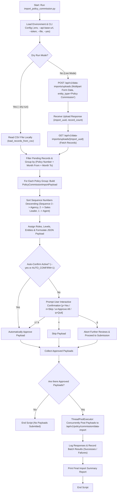

# Policy Commission Import & Validation Scripts
===================================================

This folder contains the CLI scripts for validating and importing policy commission data into the PieQ backend.

## Workflow & Process Flow Chart



---

## Detailed Step-by-Step Flow Explanation

1. **Initialization & Configuration**:
   - Parses CLI flags (`--file`, `--api-base-url`, `--token`, `--batch-size`, `--dry-run`, `--yes`, `--verbose`).
   - Reads environment variables from `.env` file or shell environment (`API_BASE_URL`, `AUTH_TOKEN`, `BATCH_SIZE`, `AUTO_CONFIRM`).

2. **File Upload (`POST /api/v1/data-imports/uploads`)**:
   - Uploads the input CSV file as multipart form-data with `entity_type="Policy Commission"`.
   - Receives response containing `import_uuid` and `record_count`.

3. **Fetching Records (`GET /api/v1/data-imports/uploads/{import_uuid}`)**:
   - Fetches all record objects generated by backend parsing.

4. **Policy Grouping & Hierarchy Split Calculation**:
   - Groups records by `Policy Number + Month From + Month To`.
   - Sorts `Sequence` **descending**:
     - Highest sequence $\rightarrow$ `Agency` (order 1, entity `"agency"`, level `""`)
     - 2nd sequence $\rightarrow$ `Sales Leader` (order 2, entity `"agent"`, level `"Level 1"`)
     - 3rd sequence $\rightarrow$ `Agent` (order 3, entity `"agent"`, level `"Level 2"`)
     - 4th+ sequence $\rightarrow$ `Sub Agent` (order 4+, entity `"agent"`, level `"Level N"`)

5. **Interactive Payload Confirmation**:
   - Displays the formatted policy setup summary and JSON payload.
   - User controls:
     - `y` (or Enter): Approve this policy setup.
     - `n`: Skip this policy setup.
     - `a`: Approve this and all remaining policy setups without asking again.
     - `q`: Abort review and proceed to process whatever was approved.
   - Pass `--yes` or `-y` to skip prompting and auto-approve all payloads.

6. **Parallel API Submission (`POST /api/v1/policy/commission/data-import`)**:
   - Sends approved payloads concurrently via thread pool (matching configured batch size).

7. **Logging & Reporting**:
   - Prints timestamped logs `[HH:MM:SS] [INFO]` for each step and HTTP response.
   - Prints final summary table of total formatted, approved, skipped, succeeded, and failed setups.

---

## Script Usage

### Interactive Mode (Asks Confirmation for Each Policy)
```bash
python3 import_policy_commission.py \
  --file /Users/nirmalrajaak/Downloads/Commission_Upload_today.csv \
  --api-base-url https://preprod.api.pieq.ai \
  --token <YOUR_AUTH_TOKEN>
```

### Dry-Run Mode (Preview Payloads Locally Without Posting)
```bash
python3 import_policy_commission.py --dry-run --file /Users/nirmalrajaak/Downloads/Commission_Upload_today.csv
```

### Auto-Approve Mode (Skip Confirmation Prompt)
```bash
python3 import_policy_commission.py --yes --file /Users/nirmalrajaak/Downloads/Commission_Upload_today.csv
```

---

---

## Environment Configuration (`.env`)
```env
# Backend API Base URL
API_BASE_URL=https://prod.api.pieq.ai

# Required Client Identity Headers
X_CLIENT_ID=pieq
X_SERVICE_NAME=pieq

# Keycloak SSO Auto-Authentication & Token Refresh Settings
AUTH_URL=https://prod.auth.pieq.ai
KEYCLOAK_CLIENT_ID=pieq-app
USERNAME=your_email@pieq.ai
PASSWORD=your_password

# Default Sample File Path (CSV or XLSX)
UPLOAD_FILE_PATH=/Users/nirmalrajaak/Downloads/7th September Commission Update - First 3000.xlsx

# Parallel Worker Batch Size (Default: 5)
BATCH_SIZE=5
AUTO_CONFIRM=0
```

---

## Automatic Failed Records Excel Export & Keycloak SSO

1. **Keycloak SSO Password Grant Auto-Authentication & Refresh**:
   - Token Endpoint: `{AUTH_URL}/realms/pieq-sso/protocol/openid-connect/token`
   - Form Body: `grant_type=password`, `client_id=pieq-app`, `username={USERNAME}`, `password={PASSWORD}`.
   - If an existing token expires (`HTTP 401/403`), the script automatically re-authenticates with Keycloak to fetch a fresh `access_token` and seamlessly retries the request.

2. **Failed Line Items Export to Excel (`.xlsx`)**:
   - If any policy payload submission fails, the script collects all original CSV/XLSX line items belonging to the failed policy setup, attaches `Import_Error_Reason`, and writes them out to a timestamped Excel file (e.g., `failed_policy_commission_import_20260908_130900.xlsx`).
   - Users can directly open this file, correct the data errors, and re-upload it as a new import process.

